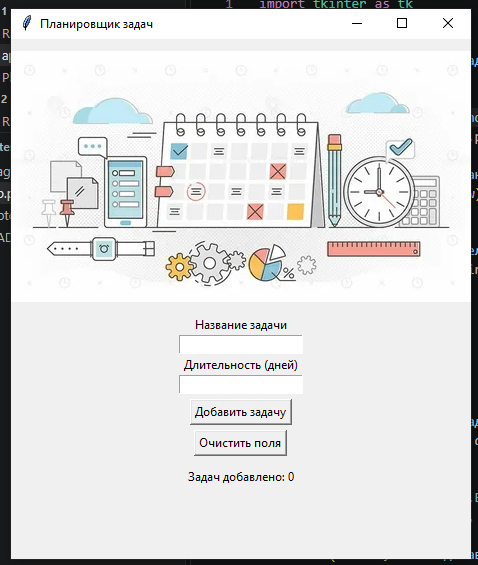

# Планировщик задач

## Участники команды
- Дёгтев Павел Кириллович (разработчик)
- Сипачёв Никита Михайлович (заказчик и тестировщик)

## Назначение
Приложение для планирования задач

## Техническое задание
- Размер окна: 460x520
- Фото в приложении: любое тематическое
- Поля ввода
- Кнопки "Добавить задачу" и "Количество дней"
- Счётчик

## Запуск
Для запуска надо запустить программу app.py

## Скриншот

## Результат проверки
Проверяющий: Сипачёв Никита Михайлович